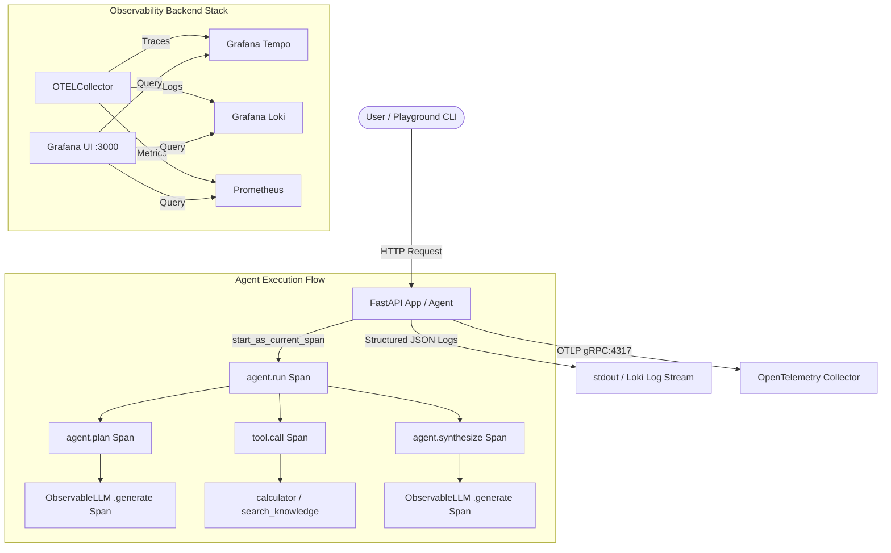

# Observable Agent: A Production-Style Observability Tutorial System

[](https.python.org)
[](https://opentelemetry.io/)
[](https://grafana.com/)

A minimal, production-style agentic AI application built with **FastAPI**, **OpenTelemetry**, **Prometheus**, **Loki**, **Tempo**, and **Grafana**.

> [!IMPORTANT]
> **Primary Learning Objective**: The main goal of this codebase is **NOT** the agent logic itself. The primary objective is to teach and demonstrate how **OpenTelemetry**, **Distributed Tracing**, **Structured Logging**, **Metrics**, **Log/Trace Correlation**, and **Collector Pipelines** work in agentic AI architectures.

---

## Table of Contents

1. [Why Observability Matters for AI Agents](#1-why-observability-matters-for-ai-agents)
2. [The Three Pillars: Logs vs Metrics vs Traces](#2-the-three-pillars-logs-vs-metrics-vs-traces)
3. [System & Telemetry Architecture](#3-system--telemetry-architecture)
4. [Trace Context & W3C Propagation](#4-trace-context--w3c-propagation)
5. [Log / Trace Correlation Mechanics](#5-log--trace-correlation-mechanics)
6. [LLM & Tool Instrumentation](#6-llm--tool-instrumentation)
7. [Why the OpenTelemetry Collector Exists](#7-why-the-opentelemetry-collector-exists)
8. [Observability Playground CLI](#8-observability-playground-cli)
9. [10-Minute Observability Walkthrough](#9-10-minute-observability-walkthrough)
10. [Verification & Test Suite](#10-verification--test-suite)
11. [Summary of Key Concepts](#11-summary-of-key-concepts)

---

## 1. Why Observability Matters for AI Agents

Unlike traditional deterministic web API requests (where input $X$ directly maps to database query $Y$ and response $Z$), AI agents execute **dynamic, non-deterministic reasoning loops**:
* An agent may decide to call a tool zero times, once, or multiple times.
* LLMs can experience transient rate limits, high prompt processing latencies, or context overflow.
* Tool calls can fail due to invalid generated arguments.

Without deep observability, debugging an agentic failure becomes guesswork. Observability provides empirical visibility into **what the agent planned**, **which tools were selected**, **token usage and financial cost**, and **where latencies/errors originated**.

---

## 2. The Three Pillars: Logs vs Metrics vs Traces

Using this codebase as a practical reference, here is how the three pillars of telemetry function:

| Telemetry Type | Core Question Answered | Example in this Codebase |
| :--- | :--- | :--- |
| **Logs** | *"What happened?"* (Discrete events with context) | `{"message": "LLM call completed", "trace_id": "daa0cd1f...", "duration_ms": 110.0}` |
| **Metrics** | *"How fast, how much, how often?"* (Aggregates over time) | `llm_call_duration_seconds{model="gpt-4o"}`, `llm_total_tokens`, `agent_errors_total` |
| **Traces** | *"What exact path did this specific request take?"* (Causal flow & hierarchy) | `HTTP POST /agent/run` $\rightarrow$ `agent.run` $\rightarrow$ `agent.plan` $\rightarrow$ `llm.call` $\rightarrow$ `tool.call` |

---

## 3. System & Telemetry Architecture

The system uses an **OpenTelemetry Collector** as an intermediate buffer and telemetry router to decouple the application from backend storage engines:



---

## 4. Trace Context & W3C Propagation

### Key Telemetry Identifiers

* **Trace ID**: A 128-bit globally unique identifier (32 hex characters) representing an entire request journey across all system boundaries.
* **Span ID**: A 64-bit unique identifier (16 hex characters) representing a single unit of contiguous work within a trace.
* **Parent Span ID**: The Span ID of the enclosing operation. If null, the span is a **Root Span**.

### Causal Span Hierarchy in `ObservableAgent`

When a user sends a request to `ObservableAgent`, OpenTelemetry establishes a parent-child relationship tree:

```text
HTTP POST /agent/run (Trace ID: daa0cd1f57d3e0d7f2139b26ecb26dde)
  │
  └── agent.run (Span ID: 48cb5c2b82a1729f, Parent: None)
        │
        ├── agent.plan (Span ID: 9f12a14b55c11029, Parent: 48cb5c2b82a1729f)
        │     └── llm.call (Span ID: 8e4e1cee28df6ac8, Parent: 9f12a14b55c11029)
        │
        ├── agent.tool_selection (Span ID: 6d0e76245e64f626, Parent: 48cb5c2b82a1729f)
        │     └── tool.call (Span ID: c0312019ff210a48, Parent: 6d0e76245e64f626)
        │           └── calculator (Parent: c0312019ff210a48)
        │
        └── agent.synthesize (Span ID: e109884128f7311b, Parent: 48cb5c2b82a1729f)
              └── llm.call (Span ID: df1cfd73e37c5043, Parent: e109884128f7311b)
```

In [app/agent.py](file:///c:/Users/Priyanshu/Desktop/PYTORCH/Working_on_observability/app/agent.py), parent-child hierarchy is maintained automatically via standard OpenTelemetry context blocks:

```python
tracer = get_tracer("agent")

with tracer.start_as_current_span("agent.run") as agent_span:
    # Any span started inside this context automatically sets agent_span as parent!
    with tracer.start_as_current_span("agent.plan") as plan_span:
        ...
```

---

## 5. Log / Trace Correlation Mechanics

How do you jump from a log line directly to a distributed trace in Grafana?

In [app/telemetry/logging.py](file:///c:/Users/Priyanshu/Desktop/PYTORCH/Working_on_observability/app/telemetry/logging.py), we implement `JSONTraceFormatter`. Whenever `logger.info()` or `logger.error()` is called, the formatter inspects OpenTelemetry's active span context:

```python
span = trace.get_current_span()
span_ctx = span.get_span_context() if span else None

if span_ctx and span_ctx.is_valid:
    trace_id = f"{span_ctx.trace_id:032x}"
    span_id = f"{span_ctx.span_id:016x}"
```

This guarantees every single log line includes:

```json
{
  "timestamp": "2026-10-03T08:44:56.220583+00:00",
  "level": "INFO",
  "logger": "observable-agent",
  "message": "LLM call completed successfully",
  "trace_id": "daa0cd1f57d3e0d7f2139b26ecb26dde",
  "span_id": "8e4e1cee28df6ac8",
  "duration_ms": 110.02,
  "input_tokens": 19,
  "output_tokens": 22,
  "cost_usd": 0.000006
}
```

In Grafana, Loki is provisioned with a `derivedField` that matches `"trace_id": "([a-f0-9]{32})"` and renders a clickable hyperlink directly opening the trace in Grafana Tempo!

---

## 6. LLM & Tool Instrumentation

### 1. `ObservableLLM` Wrapper ([app/llm.py](file:///c:/Users/Priyanshu/Desktop/PYTORCH/Working_on_observability/app/llm.py))
Wraps model API calls to measure:
* Latency (`llm.latency_ms`)
* Prompt token & response token counts (`llm.request_tokens`, `llm.response_tokens`)
* Financial cost (`llm.cost_usd` calculated via `calculate_llm_cost`)
* Metric increments (`llm_calls_total`, `llm_call_duration_seconds`, `llm_cost_usd_total`)

### 2. `@observable_tool` Decorator ([app/tools.py](file:///c:/Users/Priyanshu/Desktop/PYTORCH/Working_on_observability/app/tools.py))
A Python decorator applied to tools (`calculator`, `search_knowledge`):
```python
@observable_tool(name="calculator")
async def calculator(expression: str) -> str:
    ...
```
Automatically creates a `tool.call` span, records `tool.name` & `tool.input` attributes, tracks duration, handles exceptions, and increments `tool_calls_total` metrics.

---

## 7. Why the OpenTelemetry Collector Exists

Instead of sending telemetry directly from application code to every backend (Tempo, Loki, Prometheus), the app sends a single unified **OTLP stream** to the OpenTelemetry Collector.

### Benefits of the Collector:
1. **Decoupling**: Application code only knows OTLP (`localhost:4317`). You can change storage backends (e.g. swap Tempo for Datadog or Jaeger) without modifying code.
2. **Batching & Performance**: The collector buffers telemetry in memory and exports in batches, preventing network overhead in the main application loop.
3. **Multi-destination Routing**: A single OTLP trace stream can be duplicated to local Tempo storage AND cloud vendor destinations simultaneously.

---

## 8. Observability Playground CLI

We provide a built-in CLI tool ([app/playground.py](file:///c:/Users/Priyanshu/Desktop/PYTORCH/Working_on_observability/app/playground.py)) to simulate different operational scenarios:

```bash
# 1. Run normal search request
python -m app.playground normal

# 2. Run mathematical execution request
python -m app.playground math

# 3. Simulate tool failure scenario
python -m app.playground tool-error

# 4. Simulate LLM provider error scenario
python -m app.playground llm-error

# 5. Simulate slow agent timeout
python -m app.playground slow
```

---

## 9. 10-Minute Observability Walkthrough

Follow these exact steps to run the stack and debug requests using telemetry:

### Step 1: Start Infrastructure via Docker Compose
```bash
docker-compose up -d --build
```
Verify all containers (`observable-agent`, `otel-collector`, `tempo`, `loki`, `prometheus`, `grafana`) are healthy.

### Step 2: Trigger Normal Agent Execution
```bash
curl -X POST "http://localhost:8000/agent/run" \
     -H "Content-Type: application/json" \
     -d '{"prompt": "What is OpenTelemetry?"}'
```

### Step 3: Trigger a Simulated Failure
```bash
curl -X POST "http://localhost:8000/agent/run" \
     -H "Content-Type: application/json" \
     -d '{"prompt": "Calculate 25 * 17", "simulate_tool_failure": true}'
```

### Step 4: Open Grafana
Navigate to `http://localhost:3000` (Login: `admin` / Password: `admin`).

### Step 5: Inspect the Dashboard
1. Open the **Observable Agent Overview** dashboard.
2. Observe total execution counts, error counters, token consumption, and latency histograms updating in real-time.

### Step 6: Trace & Log Correlation in Explore
1. Go to **Explore** $\rightarrow$ select **Tempo** data source.
2. Click **Search** $\rightarrow$ select service `observable-agent` $\rightarrow$ click **Run Query**.
3. Select the trace for your failed request.
4. Observe the red span marked `StatusCode.ERROR` on `tool.call`.
5. Click **Logs for this span** to jump directly into Loki logs showing the exact exception traceback!

---

## 10. Verification & Test Suite

Run the full pytest suite validating OpenTelemetry span creation, trace context log formatters, error statuses, and Prometheus metrics:

```bash
# Run pytest in virtualenv
python -m pytest
```

Output:
```text
tests/test_agent.py ....                                                 [ 30%]
tests/test_observability.py .....                                        [ 69%]
tests/test_tools.py ....                                                 [100%]
============================= 13 passed in 0.86s ==============================
```

---

## 11. Summary of Key Concepts

```text
What is Observability?
  -> The ability to understand system internal state strictly by inspecting its external outputs (telemetry).

Why are logs alone insufficient?
  -> In concurrent or distributed systems, logs become an unorganized stream of interleaved text lines. 
     Without Trace IDs, linking logs from the same user request is impossible.

What is a Span?
  -> A single unit of contiguous work containing a name, timestamps, status code, key-value attributes, and events.

How does Context Propagation work?
  -> Trace context (Trace ID, Span ID) is passed across thread context managers and HTTP headers (W3C traceparent), 
     allowing child spans to reference their parent span ID.

What does an OpenTelemetry Collector do?
  -> It receives, processes (batches/filters), and exports telemetry data across multiple backend vendors via standard OTLP protocols.
```
